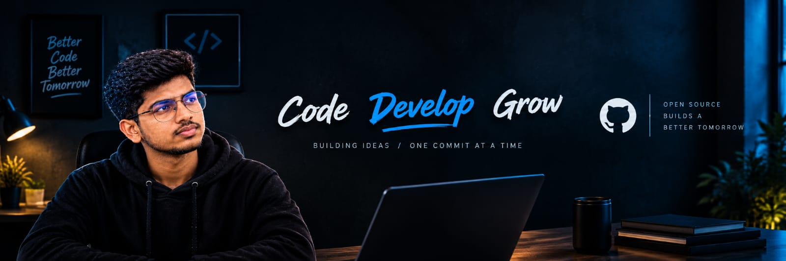

  

  
  
  

<h1 align="center">Software Engineer in the Making.</h1>

<b>B.Tech CSE • 2027</b> &nbsp;·&nbsp; Full-Stack Development &nbsp;·&nbsp; DSA & Problem Solving &nbsp;·&nbsp; AI/ML & Cloud

Ranchi, Jharkhand 🇮🇳

---

## 👋 Hi, I’m Abhishek

I build software by **learning the fundamentals, solving problems, and shipping working products**.

My current focus is full-stack engineering with **React, Node.js and REST APIs**, while strengthening **DSA, Java/Python, databases, cloud development and AI/ML fundamentals**.

**Target:** Software Engineering / Full-Stack Development roles.

### ⚡ At a glance

| | |
|---|---|
| 🎓 **Education** | B.Tech Computer Science Engineering — Ramgarh Engineering College (JUT), 2023–2027 |
| 💻 **Core** | Java · Python · JavaScript · React · Node.js · Express |
| 🧠 **Problem Solving** | Data Structures · Algorithms · Complexity fundamentals |
| ☁️ **Additional** | MongoDB · SQL · Microsoft Azure · Azure Cognitive Services |
| 🔬 **Experience** | NIAMT Research Intern · AI Azure Intern · GeeksforGeeks Campus Mantri |
| 🏆 **Recognition** | Bronze Medal — IIT Bombay Techfest |

---

## 🚀 Selected Work

> **A small number of projects, chosen for signal rather than volume.**

### 🛍️ [Saanjh — MERN E-commerce](https://github.com/Abhishek7258/saanjh_mern_ecommerce)
**Full-stack store with JWT authentication, an admin dashboard, cart and Razorpay checkout with server-side payment-signature verification.**
`React` `Vite` `Node.js` `Express` `MongoDB` `Razorpay` · Full-stack

### 🏥 [BabyMaker IVF](https://github.com/Abhishek7258/BabyMakerIvf)
**Multi-page IVF clinic website with a booking flow, rule-based chatbot and theme switching.**
`React` `Vite` `Tailwind CSS` `React Router` · Client-oriented development

### 🧹 [SFAIwala](https://github.com/Abhishek7258/sfaiwala)
**Responsive cleaning-services website with a service catalogue and WhatsApp enquiries.**
`React` `Vite` `Tailwind CSS` · Frontend

### 🩺 [NIAMT Project](https://github.com/Abhishek7258/NIAMT-Project)
**Medical symptom checker built during a research internship, powered by the Gemini API.**
`JavaScript` `Gemini API` `HTML/CSS` · AI-assisted web app

### 🛡️ [DeepShield](https://github.com/Abhishek7258/Deepsheild)
**Image-cloaking toolkit exploring GAN-style perturbations, DCT watermarking and detection.**
`Python` `TensorFlow` `OpenCV` `Tkinter` · Research / experimentation

---

## 💼 Experience

**Research Intern — NIAMT Ranchi** · *Jul 2025*  
Developed and debugged Python ML workflows for an AI-powered medical symptom checker, including preprocessing, data cleaning, testing and validation.

**AI Azure Intern — Microsoft / AICTE (Edunet Foundation)** · *Jun 2025*  
Built and deployed AI-driven applications using Python, Azure Cognitive Services and REST APIs; debugged cloud deployment issues during a four-week program.

**Campus Mantri — GeeksforGeeks** · *Jan 2026 – Present*  
Coordinate with student teams and GeeksforGeeks staff to run mentorship, coding and hackathon activities, building communication and project-coordination skills.

---

## 🧰 Engineering Toolkit

Languages · Frontend · Backend · Databases · Cloud · Developer Tools

---

## 🏆 Beyond Code

- 🥉 **Bronze Medal — IIT Bombay Techfest**, recognized for contribution as a College Ambassador.
- 🎯 **GeeksforGeeks Campus Mantri**, selected as an official student representative.
- 🎓 **7.76/10 CGPA** through 5th semester, with no active backlogs.

---

## 🧠 Currently Building Depth

**DSA & Problem Solving** → stronger algorithmic thinking and complexity analysis  
**Full-Stack Engineering** → React + Node.js + REST APIs + databases  
**Cloud & AI/ML** → Azure workflows and practical Python-based ML  
**Engineering Practices** → debugging, testing, clean structure and reliable delivery

---

## 📊 GitHub Snapshot

 

---

## 🔗 Let’s Connect

 

<i>Build with purpose. Solve with fundamentals. Improve every day.</i>
